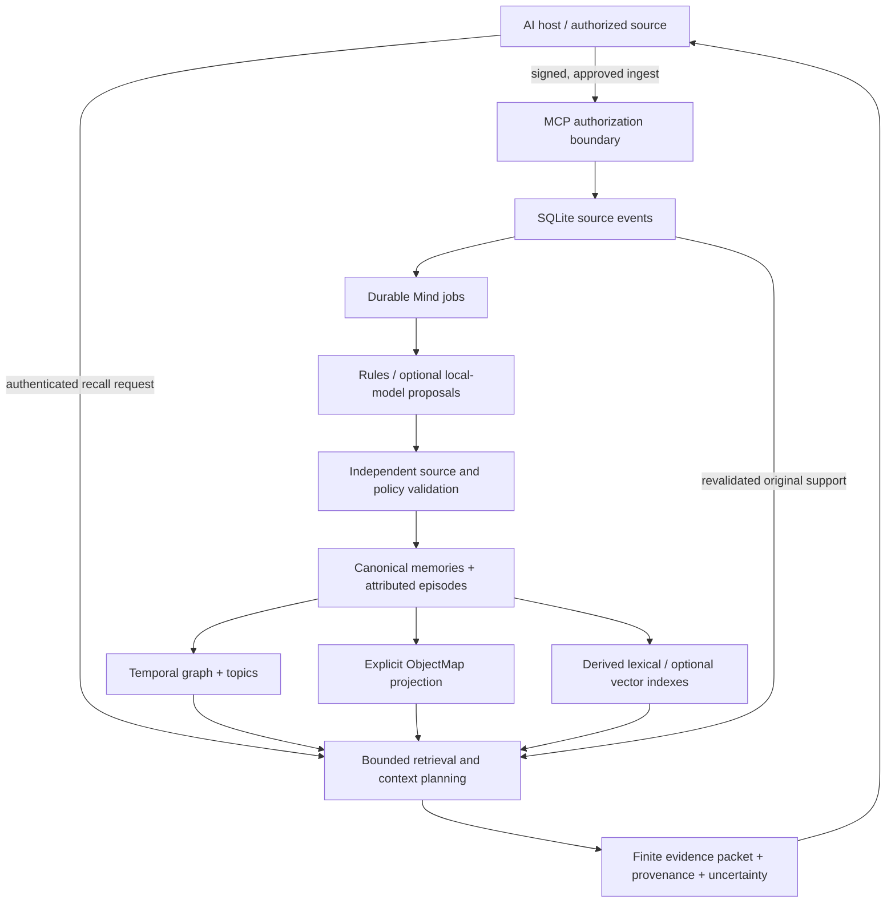

# OOMP · Object-Oriented Context Map

**Memory beyond the context window.**

Persistent history. Selective recall. Finite prompt.

[](pyproject.toml)
[](LICENSE)
[](docs/SUBMISSION-READINESS.md)

OOMP is a local-first persistent-memory layer for AI hosts. It stores original
source events, derives attributed memories, and retrieves relevant evidence from
earlier sessions for a finite model prompt. Projects, preferences, plans and
discussions can remain inspectable after they leave the recent conversation.

**OOMP supplies evidence; the host's language model generates the answer.** It
does not expand a model's native context window or establish that a source claim
is true. Version **0.1.0** is an alpha research candidate.

[Quickstart](#quickstart) · [Architecture](#architecture) · [Inspect memory](#inspect-stored-memory) · [Integration](#connect-an-ai-host) · [Status](#project-status) · [Documentation](#documentation)

## Why OOMP?

An AI application needs more than a longer transcript to resume earlier work.
It needs to select the right prior evidence, retain changed intentions, explain
where a claim came from, and keep one identity's history out of another's context.

| Need | Implemented approach |
| --- | --- |
| Continue across sessions | SQLite source history and selective recall, independent of the answer model |
| Inspect an answer's support | Original event IDs, source references and exact validated spans |
| Keep changing plans understandable | Distinct occurrence, recording and validity semantics; governed corrections and retractions |
| Navigate related memories | Stable objects, explicit aliases, multiple hierarchy paths and typed graph relationships |
| Work without a model service | Deterministic extraction and lexical retrieval; model use is an explicit option |
| Operate locally | Private profiles, owned MCP/Mind processes, diagnostics and read-only inspection tools |

## Quickstart

Python **3.11+**, SQLite with **FTS5**, and Pydantic are the core requirements.
Python 3.11 and 3.12 have recorded validation; exact environments and test scope
are linked below. TRACE, MongoDB, a GPU and model credentials are unnecessary for
core operation.

### Installation

The product candidate is on `feature/p4-retrieval-quality`; `main` can represent
an earlier accepted integration. Install from the checkout containing this README.
These commands do not assume a published PyPI package or release image.

```powershell
git clone --branch feature/p4-retrieval-quality https://github.com/hamzah105/OOMP.git
cd OOMP
py -3.11 -m venv .venv
.\.venv\Scripts\Activate.ps1
python -m pip install ".[mcp,ui]"
oomp --version
python examples/quickstart.py
```

On Linux/macOS, create the environment with `python3 -m venv .venv` and activate
it with `source .venv/bin/activate`, then use the same install/demo commands.
The core-only alternative is `python -m pip install .`; `[mcp]` adds the official
MCP SDK/server dependencies, `[ui]` adds optional color/keyboard menus, and `[dev]`
adds pytest. Plain output and `NO_COLOR` remain available.

The core example uses temporary fictional data, checks persistence and bounded
source-backed recall, and makes no model calls. It changes no normal profile.

### Exercise managed services with fictional data

With `[mcp]` installed, the public walkthrough creates its own isolated profile,
performs signed intake, drains a separate Mind worker, inspects the object map,
checks context/provenance and verifies restart/shutdown:

```powershell
$demo = Join-Path $env:TEMP ('od-' + [Guid]::NewGuid().ToString('N').Substring(0,8))
python examples/submission_demo.py --directory $demo
$result = Get-Content (Join-Path $demo 'acceptance.json') -Raw | ConvertFrom-Json
```

The target must be **new**, its parent must exist, and Windows paths should stay
short. The demonstration uses rules-only extraction and no TRACE, MongoDB,
embedding model or answer model. Its retained fictional profile contains private
credentials: keep the directory out of Git and inspect the credential-free JSON
reports rather than printing `secrets.json`.

### Configure your own profile

`oomp onboard` previews configuration and asks before creating a new database or
credentials. It starts no services and never adopts an existing database as new.

| Command | Purpose |
| --- | --- |
| `oomp onboard --profile NAME` | Guided setup; explicit host, scope and authority choices |
| `oomp config --profile NAME --json` | Inspect settings and secret references without values |
| `oomp up --profile NAME` | Foreground supervisor; Ctrl+C stops owned services |
| `oomp up --profile NAME --background` | Explicit background supervision |
| `oomp doctor --full --profile NAME` | Report PASS / WARN / FAIL / NOT TESTED accurately |
| `oomp status --profile NAME` / `oomp logs --profile NAME` | Authenticated runtime status / bounded operational codes |
| `oomp down --profile NAME` | Stop only the authenticated owning supervisor |

Add `--home PATH` when using a nondefault profile root. For the separately approved
persistent TRACE setup, `oomp start` reuses the saved selection and credentials;
`oomp stop`, bare status and full doctor use that selection. First-time TRACE
setup requires the reviewed matching TRACE bootstrap, owner validation and file
approval. It does not install arbitrary host code. See the
[two-terminal guide](LOCAL-LIVE-QUICKSTART.md) and [operator guide](docs/product-onboarding.md).

## Architecture



The trusted in-process Python API is another interface to the same engine.
Remote hosts communicate over MCP; an authenticated grant supplies their scope.
The host validates its authoritative source ownership before using returned
evidence. Source text, summaries and retrieved packets remain untrusted data.

### What is stored?

| Layer | Role |
| --- | --- |
| Source events | Original messages/documents, role, source identity and timestamps, subject to explicit retention/erasure governance |
| Canonical memories | Attributed claims linked to original evidence through `memory_sources` |
| Entities and objects | Source-supported identity/alias records and stable typed object anchors |
| Temporal graph and topics | Many-to-many relationships, memberships and controlled correction/conflict lineage |
| Episodes and summaries | Attributed discussion segments and source-backed extractive revisions |
| ObjectMap | A bounded navigational DAG over existing eligible records, with referenced proofs |
| Retrieval indexes | Derived FTS5/BM25 and optional compatible embedding-space caches |
| Mind state | Durable jobs, retries, leases/fencing, review proposals and maintenance audit |

The hierarchy does **not** replace the graph or duplicate original evidence into
every path. One object can appear under several topics. P3 projection is explicit;
a read does not silently build a map, refresh an index or rewrite a summary.

## Inspect stored memory

Managed profile settings expose the configured `database`, `tenant`, `namespace`
and `principal` through `oomp config --profile NAME --home PATH --json`.
These are filesystem-authorized local administrative operations, not remote
authentication. Keep private profile configuration out of shared diagnostics.

The following commands inspect **only the fictional walkthrough above**:

```powershell
$db = $result.database
$scope = @('--db', $db, '--tenant', $result.scope.tenant, '--namespace', $result.scope.namespace, '--principal', $result.scope.principal)
oomp storage status --db $db
oomp memory list --db $db --tenant $result.scope.tenant --namespace $result.scope.namespace --limit 20
oomp memory tree @scope --depth 7 --limit 100 --json
oomp memory inspect $result.project_object_id @scope --show-provenance --json
oomp memory history $result.project_object_id @scope --json
oomp memory explain $result.project_object_id @scope --json
oomp memory find LUMENDEMO @scope --json
oomp memory export @scope --redacted --json
```

`memory list` lists canonical-memory IDs and evidence counts; it is a legacy
tenant/namespace view. The other commands inspect the principal-selected P3
projection. An empty tree can mean the map has not been built even when source
events or canonical memories exist. Do not run `build-map`, `rebuild-map`,
`memory index` or `storage init` as an inspection step on private storage.

Defaults hide source excerpts, but labels and identifiers can still be private.
`--show-content` explicitly reveals content to the trusted operator. Object
export is always redacted; stable IDs can still permit correlation. See the
[complete object CLI](docs/object-memory-cli.md) for temporal filters and limits.

SQLite is the persistent store, independent of TRACE's MongoDB. For a database
browser or direct SQL, prefer an owner-approved **WAL-consistent snapshot** opened
read-only. Copying only a live `.sqlite3` file can omit committed WAL data;
`immutable=1` is not a safe shortcut for inspecting an active WAL database.
Follow [storage](docs/storage.md) and [backup/retention](docs/privacy-retention.md).

## Connect an AI host

The optional official **MCP 2.3** adapter supports stdio and authenticated
loopback Streamable HTTP. Read authority, raw-source access, signed ingestion
approval and privileged local erasure are separate boundaries. Ordinary retrieval
does not gain write authority.

`memory.retrieve` retains its existing contract. The opt-in `memory.context`
tool adds `oomp.context.v1`: bounded intent planning, canonical/object/episode
evidence resolutions, original-source checks and explicit uncertainty/failure
states. Existing profiles keep context retrieval disabled unless selected with
`--context`. The inherited `token_budget` field counts **UTF-8 packet bytes**,
not exact model tokens; the outer protocol and host prompt need additional space.

An independent host example uses the SDK without importing OOMP internals:

```powershell
python examples/generic_context_host.py 'What projects have I discussed?' --token-budget 6000 --get-source
```

This requires an already authorized context-enabled endpoint and a reader secret
provided through the documented `MCP_BEARER_TOKEN` environment reference. It reads
no database, starts no service/model and requests source metadata only.
[Generic host guide](docs/generic-context-host.md) · [MCP tools and grants](docs/mcp-integration.md) · [Context contract](docs/context-retrieval-api.md)

[TRACE.AI](https://github.com/hamzah105/trace-ai-chatbot) is a separate FastAPI /
MongoDB / Ollama chatbot. Its approved publication worker sends eligible completed
interactions; its retrieval path verifies owner/session/role provenance against
MongoDB before selecting OOMP evidence for a bounded prompt. OOMP remains usable
without TRACE, and TRACE can operate with memory disabled. Compatibility with
every MCP host or public cloud deployment is not claimed.

## Project status

The original [Stage 1–10 history](docs/roadmap.md) and the later
[P1–P5 product roadmap](docs/product-roadmap.md) are separate tracks. The October
2026 proposal is design intent; current source and dated reports determine status.

| Product milestone | Current evidence |
| --- | --- |
| P1 · onboarding and operations | Implemented and locally validated; persistent two-terminal TRACE startup has current focused evidence |
| P2 / P2.1 · conversational acquisition | Rules, attributed episodes and independently validated local-model proposals implemented; one incremental real-model memory persisted in a controlled synthetic case |
| P3 · object memory | Implemented and validated: schema v6, stable identities, multiple navigation paths and original-source proofs |
| P4 · context virtualization | Engine and TRACE adapter implemented; local Gates A/C accepted, Gate B answer evaluation incomplete |
| P5 · product/research readiness | Submission-focused demos, packaging and usability work implemented; full independent research/release gates remain pending |

### Measured validation, with its limits

- **P2.1:** one independently validated incremental model proposal persisted
  through a real Mind job and database reopen. This does not establish broad
  extraction quality. [Acceptance report](docs/product-milestone-P21-model-acceptance.md)
- **P3:** 767 tests passed on each of Windows Python 3.11 and 3.12 at that source
  snapshot. [P3 report](docs/product-milestone-P3-report.md)
- **P4 Gate A:** 137/137 checks, 12/12 frozen scenarios, source recall 16/16 and
  precision 16/18. **Gate C:** 18/18 independent-host checks. These are local
  experimental results. [Final P4 record](docs/P4-FINAL-ACCEPTANCE.md)
- **P4 Gate B:** 22 model answers, one deadline failure and 41 unrun cases out
  of 64 planned. On five fully paired cases, OOMP and flat lexical each scored
  3/5. No superiority or full P4 acceptance is demonstrated.
- **Submission preparation:** four core-only clean installs and 32 CLI checks;
  111 focused tests on each Python version. [P5 report](docs/P5-SUBMISSION-REPORT.md)
- **Local startup:** 94 unique focused OOMP passes; separate TRACE startup,
  authenticated configuration discovery and doctor evidence. Real browser login
  and final model answers remain manual. [Startup report](docs/local-start-validation.md)

These counts belong to their stated snapshots and overlap; they are not one
current full-suite total. [Stage 9](docs/stage9-validation.md) remains a separate
historical synthetic retrieval study. Independent label review, pilot users,
public benchmark validation and comparable Mem0/Graphiti studies remain pending.

## Security and practical limits

- SQLite, local profiles and backups are plaintext; protect them with OS access
  controls and disk encryption. Never commit databases/WAL/SHM files, credentials,
  `.env`, private configuration, conversation exports or real chat fixtures.
- Submission use is restricted to **one principal per dedicated namespace/profile**.
  The default multi-principal shared-queue projection defect remains open.
- `memory.context` applies principal-specific ownership. Legacy retrieval and
  `memory.get_source` retain their documented tenant/namespace read boundary;
  isolate mutually untrusted hosts with separate scopes and credentials.
- Rules and sensitive-data heuristics have limited coverage. Optional local-model
  proposals require explicit configuration and independent validation; provider
  failure retains deterministic fallback. OOMP downloads no model weights.
- Similarity, summaries and association paths do not prove truth. Temporal
  uncertainty, correction review and negative controls remain necessary.
- Storage/retrieval work is bounded; vectors use exact scans rather than a
  large-scale ANN service. Erasure does not securely wipe old pages or backups.
- Loopback development validation does not certify public TLS/proxy hosting,
  enterprise security, kernel stability or universal host compatibility.

[Full limitations](docs/limitations.md) · [Security model](docs/security-model.md) · [Report a vulnerability](SECURITY.md)

## Documentation

| Start here | Go deeper |
| --- | --- |
| [Local two-terminal quickstart](LOCAL-LIVE-QUICKSTART.md) | [Product CLI](docs/product-cli.md) and [onboarding](docs/product-onboarding.md) |
| [Synthetic manual walkthrough](docs/MANUAL-TESTING.md) | [Source/canonical memory model](docs/memory-model.md) and [extraction](docs/mind2-design.md) |
| [Python/API guide](docs/api-reference.md) | [Object architecture](docs/object-memory-architecture.md) and [temporal graph](docs/temporal-graph.md) |
| [Retrieval](docs/retrieval.md) | [Context architecture](docs/context-virtualization-architecture.md) and [Mind workers](docs/background-mind.md) |
| [Submission readiness](docs/SUBMISSION-READINESS.md) | [Release checklist](docs/release-checklist.md) and [research methodology](docs/benchmark-methodology.md) |

## Contribute

Read [CONTRIBUTING](CONTRIBUTING.md), the [developer guide](docs/developer-guide.md)
and [Code of Conduct](CODE_OF_CONDUCT.md). Use fictional data and fresh disposable
paths for tests; keep real provider calls explicitly separate from offline work.
Historical acceptance records and frozen fixtures must stay intact.

OOMP is licensed under [Apache-2.0](LICENSE); see [NOTICE](NOTICE) and
[third-party notices](THIRD_PARTY_NOTICES.md). Package/release publication is a
separate maintainer action, not implied by source availability or passing tests.
