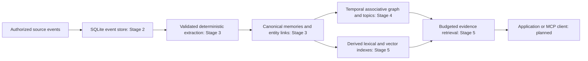

# Architecture

## Purpose and current boundary

OOMP is an independent external memory library, not a chatbot or an application-specific conversation database. Its output is evidence, source references and retrieval metadata. Applications remain responsible for composing prompts and generating final answers. Stage 1 implements contracts and the package CLI; Stage 2 adds the SQLite source-event adapter. Stage 3 implements deterministic extraction and canonical-memory/entity persistence; Stage 4 implements the temporal associative graph and topic projections; Stage 5 implements budgeted retrieval and optional local embeddings; MCP remains planned.

## Architectural contracts

1. **Immutable source evidence.** Events preserve what was observed, by whom, when and where. A changed derived fact does not rewrite the earlier source. A future append-only store must support auditable corrections, while authorized erasure can remove protected content and dependent material. Immutability never overrides privacy or authorized deletion requirements.
2. **Canonical identity.** A memory object retains its own ID. Multiple topic memberships use edges and views, without duplicating the same fact. Canonical keys assist future deduplication but are not a global authorization domain or a promise that semantic identity is already solved.
3. **Temporal relationships.** Historical facts can coexist. Validity intervals, statuses and SUPERSEDES/CONTRADICTS edges allow future retrieval to distinguish current, conflicting and historical evidence. Unknown validity is not permanent truth.
4. **Multiple graph views.** A topic tree is a projection of a richer graph. PART_OF can support hierarchy; RELATED_TO and other relationships may contain cycles. There is no universal acyclicity invariant.
5. **Provider independence.** Domain schemas and protocols have no OpenAI, Anthropic, Ollama, LangChain, LlamaIndex or TRACE types. Adapters translate provider-specific inputs at the boundary.
6. **Evidence output.** Retrieval selects evidence, not a generated final answer. Scores and confidence remain absent unless a defined measurement supplies them.
7. **Explicit authorized scope.** Every future persistent operation receives an authorized tenant/namespace scope. Client identifiers alone are not authorization.
8. **Explicit state.** Memory identity and scope are independent of transport connections. A session, socket or MCP host is not durable memory state.

## Components and dependency direction

`domain.models` and `domain.enums` define validated values; `retrieval.contracts` defines the implemented retrieval request/response payloads. `domain.interfaces` defines EventStore, MemoryStore, GraphStore, EmbeddingProvider, MemoryExtractor and MemoryRetriever protocols. EventStore and MemoryStore have SQLite implementations, and deterministic MemoryExtractor implements the original pure extraction contract. Stage 3 orchestration validates candidate scope, evidence and allowed transformations before atomic persistence. Future authenticated services must issue authorized scopes before invoking these adapters.

Protocols are synchronous in this stage to keep local boundaries small. Async service/transport adapters may be introduced later when actual I/O warrants them; no background execution or scheduling semantics are implied. Protocol conformance does not automatically enforce policy. Implementations must compare requested scope with authorized scope and verify object scope, endpoints and evidence references inside the authorized partition.

## Storage versus indexes

SQLite is the durable source for immutable events, canonical memories, evidence links, entities and explicit aliases. Schema version 2 adds these Stage 3 records to the original event table. Schema version 3 adds typed relationship assertions, source evidence, topics, memberships and recording-time history. Durable job state remains future work. Schema version 4 adds derived, replaceable lexical/vector indexes. Rebuilding an index must not change source identities or erase provenance. Namespace isolation applies to index lookups, caches, candidate selection and final evidence, not just a last response filter.

Idempotency is scoped to tenant and namespace. The implemented append returns the original event for equivalent scoped retries and rejects conflicting ID/key reuse. Stage 2 implements transactions, schema version 1, scoped indexes and per-operation resource cleanup. Stage 3 adds derived-memory storage; privileged deletion remains future work. See the storage guide for exact fingerprint and retry semantics.

## Planned consolidation

The Stage 6 background engine may merge duplicate candidates, refine topic summaries and resolve stale derived state. It must operate on explicit authorized scope, preserve provenance, record which extraction/version produced changes, and remain resumable after failure. It must not manufacture verified truth from an assistant assertion or silently destroy earlier evidence.

## MCP and application boundaries

Stage 7 will use the official MCP Python SDK v2, exposing memory operations through stdio and stateless Streamable HTTP. As checked on 2026-10-13, the official SDK documents v2 as its stable line. No MCP package is installed in the OOMP environment. Revalidate the SDK and protocol requirements when building that adapter. [Official MCP Python SDK](https://github.com/modelcontextprotocol/python-sdk).

Authentication, authorization, input size limits, approval for privileged writes, server-side scope mapping, origin validation and safe binding belong to OOMP's service/transport boundary. MCP compatibility does not itself establish tenant authorization. Stdio inherits a local process trust boundary; HTTP requires explicit authenticated principals. Neither transport holds memory state.

TRACE.AI is the proposed first external integration in Stage 8. Its application's working conversation window remains an application concern. An adapter may ingest authorized events and retrieve evidence without embedding TRACE-specific classes in OOMP. This repository has no TRACE source, checkout or dependency, and this stage modifies no TRACE files.

## Decisions to revisit

Before future stages, revisit canonicalization-version migration and alias-driven identity changes; principals/roles and authorization policy; edge endpoint entity kinds; tombstone and erasure policy; configurable request bounds; tokenizer accounting; embedding compatibility metadata; sync/async I/O requirements; and MCP version/transport deployment settings before their respective stages.

## Stage 2 storage boundary

[SQLite storage](storage.md) documents schema version 1, configuration, transactional migrations, scoped idempotency, fixed UTC timestamp ordering, bounded keyset pages, independent connections, WAL/durability settings and backups. SQL belongs in the adapter and migration module, not domain models or CLI handlers. EventStore append/get remain compatible; listing/counting and the provider-neutral EventCursor/EventPage contracts are the only protocol additions. No Stage 1 domain invariant changes.

## Stage 3 extraction and persistence boundary

`ingestion.extraction` recognizes supported source statements and creates immutable candidates. `ingestion.pipeline` retrieves an event under AuthorizedScope and validates every candidate against actual source text and allowed deterministic transformations, even when an extractor is injected. `ingestion.canonicalization` creates MemoryNode values and stable versioned hashes. Domain contracts do not import SQLite or provider SDKs; SQL stays in storage.

`SQLiteMemoryStore.apply_batch` owns one BEGIN IMMEDIATE transaction per event: resolve entities, insert/reuse canonical memories, add source evidence, and add entity links. Any candidate/persistence conflict rolls back that event's derived writes. The already stored event remains independent. Independent connections and database uniqueness constraints protect concurrent retries.

Entities identify explicitly named subjects; memory-to-entity links record association only. They are distinct from Stage 4 MemoryEdge relationships and traversal. Stage 3 added no graph-edge table, vector column, background queue or network adapter. Stage 4 adds graph persistence separately, preserving the extraction boundary. Candidate extraction is bounded; no history-wide aggregation is performed.

The extraction model seam remains an interface only. Stage 5 adds a separate opt-in local embedding transport; no model extraction adapter or cloud provider is implemented. A future adapter proposes candidates and OOMP retains policy, validation, identity and write authority. It must never bypass the same evidence checks or write SQL directly. See [extraction](extraction.md) and [storage](storage.md).

## Stage 4 graph and governance boundary

The canonical memory store remains the sole owner of memory bodies. Graph records reference canonical MemoryNode endpoints; topics use dedicated projection records and memberships. Event/entity IDs are never forced into memory-node foreign keys. Multiple projections reference one memory identity.

Recording-time history supplements existing caller-supplied event/memory timestamps. Append-only relationship assertions and source attachment history allow valid_at and known_at filtering without destructive source updates or silently overwritten fact statuses. Pre-v3 recording times remain explicitly unknown. Historical projections must not expose evidence recorded after their knowledge cutoff.

Pure source-grounded comparison policy proposes a conflict or replacement only for documented supported slots. The SQLite transaction revalidates governed resolution against actual records and trusted scope. Models and event text have no autonomous write authority. Generic structural links are trusted attributed assertions; they are not objective verification.

General associative cycles are allowed. PART_OF, SUPERSEDES and topic hierarchy rules reject recursive chains using transactionally checked bounds. Traversal and topic trees expose explicit truncation/resource limits. See [temporal graph](temporal-graph.md). Stage 5 consumes these assertions through a scoped retrieval snapshot; graph inspection alone does not establish relevance.

## Stage 5 retrieval boundary

The retrieval engine owns planning, deterministic rank fusion, temporal relevance, bounded graph expansion, diversity and packet packing. SQLiteRetrievalStore owns schema 4 derived indexes and one scoped read snapshot reused by all candidate and proof lookups. Canonical MemoryNode/Event/Edge values remain the source of truth; embeddings never define identity. Optional embedding I/O occurs outside database read/write transactions.

Persistent FTS5 rows are backfilled and synchronized with canonical inserts. Ranking statistics come from a bounded per-scope temporary FTS5 corpus so another tenant cannot influence BM25 ranking. Scoped vectors are keyed by provider/model/configuration identity and validated dimension/content digest. Exact scans fail explicitly at capacity. Reads do not initialize, rebuild, embed memories or write conflict relationships.

The model produces vectors or proposed intent; OOMP retains validation, policy, identity, approval, durability and execution. The optional Ollama adapter is explicit, loopback-only and disabled by default. The existing source-grounded conflict policy remains authoritative. The returned evidence packet counts its own JSON, provenance and paths under a disclosed counter; diagnostics and application prompt overhead require separate host accounting. See [retrieval](retrieval.md).
