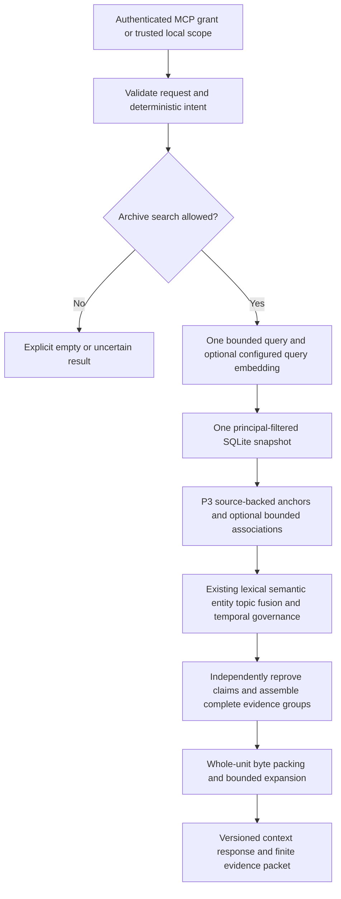

# Source-grounded context virtualization

P4 Phase A adds an opt-in context selector around existing OOMP retrieval and P2/P3 proof stores. It does not replace the retriever, generate an answer, change a model's context window or modify TRACE. Validation counts and completion status belong to the [P4A report](product-milestone-P4A-report.md); a focused pass is not a full regression or packaging certificate. See the [API reference](context-retrieval-api.md) for exact wire fields and authorization.

## One plan, one query, one read view

[`plan_request`](../src/oomp/context/planner.py) uses deterministic English intent/topic patterns, literal anchors and optional bounded recent-user referents. Up to three planned query variants are combined into one bounded term disjunction. They do not launch three independent retrieval passes. An unresolved vague reference asks for clarification without an archive scan; an explicit current-session-only request also skips durable history. Recent text is a relevance hint, not proof or permission to persist a claim.

[`ContextEngine`](../src/oomp/context/engine.py) reuses `RetrievalEngine._prepare_embedding` and its internal `_retrieve` seam. The same existing BM25/cosine/entity/topic lanes, reciprocal-rank fusion, temporal governance, graph proof rules and diversity logic rank canonical candidates. P3 candidate IDs feed an existing lane; a candidate sink exposes ranked evidence for context assembly before the legacy packet's budget can conceal otherwise eligible candidates. The public legacy retrieval entry point and response shape stay intact.

If semantic mode is explicitly configured, its single query embedding is prepared before the read snapshot, as in existing retrieval. No extractor, summary generator or model download runs as part of context selection. Missing optional providers/indexes use the existing fail/degrade policy. Synthetic embedding mocks validate mechanics only and provide no measurement of real semantic quality.

## Authority before limits and ranking

The context path opens `read_snapshot(scope, principal_only=True)`. Its SQL predicates filter ownership before corpus statistics, scan ceilings, candidate limits and embedding-coverage accounting. A foreign principal cannot consume an owner's lexical quota or influence that owner's BM25 statistics. Every source event must carry the exact explicit `ingested_by` principal; if memory metadata names a principal it must agree. Unmapped legacy ownership is withheld rather than guessed from a user name, source label or caller field.

Graph access also requires owned endpoints, owned source proofs and the recorded actor. A foreign node cannot become reachable through an otherwise local edge. All canonical/object/episode checks use the same SQLite connection, authorized scope and captured temporal selectors. The P3 adapter routes memory-state reads through that principal-filtered session rather than opening a second snapshot.

With `graph_depth > 0` and an explicit exact label anchor, [`navigation.py`](../src/oomp/context/navigation.py) can follow existing P3 associations using the same snapshot and P3 `read_relation`/object validation. Requested relationship filters, knowledge/validity time, owned backing graph actors and node/edge/work ceilings constrain the walk. Validated associated memories can add relevance without repeating the literal anchor; the relation does not make their claims true. For that request the P3 graph lane replaces optional canonical-neighbor expansion, so two independent graph budgets cannot multiply work. With depth zero, no matching exact anchor or no allowed relationships, this P3 lane is disabled; existing canonical graph policy applies where separately requested.

This stricter opt-in ownership view does not silently change legacy v1 namespace-based retrieval. It introduces no database migration or new write authority. Schema v6 must already be ready; a read cannot initialize a private profile, rebuild the object map, consolidate a summary, repair an index, backfill events or enqueue Mind work.

## Evidence admission is stronger than a valid link

[`validation.py`](../src/oomp/context/validation.py) independently re-proves canonical content. The original quote must match its stored source span and authorized event, but a correct quotation alone cannot justify an invented canonical paraphrase.

The admission helper reuses existing deterministic extraction/canonicalization and P2 `candidate_writes`. The P2 path also preserves a valid declarative clause inside a mixed question. A supported literal model refinement is checked through the existing independent validator using a source-proof label; that check constructs no provider and makes no inference request. Arbitrary manually paraphrased records are withheld. The manual exact-attribution fallback requires the complete original event, unverified source attribution and no unsupported tags; a cropped substring cannot discard a negation.

Source-role, assertion, sensitivity, retraction and validity checks follow independently. Assistant, quoted, hypothetical and question evidence is not promoted into a user identity or completed plan. An explicitly requested discussion topic does not establish political affiliation, nationality or other sensitive personal traits. A ranking score remains an uncalibrated relevance signal.

Identity relevance also checks the kind of proved claim. After `source_entails_memory` succeeds, an identity/alias topic requires an `alias` predicate and `profile` category, established by deterministic source classification or the already independently re-proved P2.1 literal refinement. Generic words such as `name` or `called` cannot by themselves make a project name answer an alias question. P2.1 forms such as an explicit "My friends call me ..." claim remain supported through their existing literal-validator proof; stored metadata alone has no admission authority. An intentionally mixed alias-and-project request retains OR semantics across its requested topics, so project evidence can still answer its project component.

## Coarse views, claims and source detail

The context selector can produce four resolutions:

| Resolution | Basis and constraint |
| --- | --- |
| `object_snapshot` | A compact P3 type/label/alias/status view. Every original event/span supporting that exposed view must be admitted; a filtered newer proof cannot leave its label behind. Otherwise the snapshot is omitted and eligible claims remain candidates. |
| `episode_summary` | An existing P2 extractive revision, with content/fingerprint recomputed against current or requested-as-of episode members and independently re-proved source support. Its bounded stored `mind_summary_sources` manifest must exactly equal the reconstructed memory/event support; missing members cannot be silently recreated during a read. An invalid stored revision makes coverage partial. A valid summary omitted because its support is irrelevant or unselected is a selection outcome, not evidence of index corruption. |
| `canonical_fact` | Whole independently supported canonical content, retaining attribution, temporal uncertainty and original proof identity. A correction-review association does not itself authorize supersession. |
| `source_evidence` | An explicit expansion carrying original source-span detail. MCP requires `read_source` as well as the request flag; canonical readable evidence is not equivalent to a full-source grant. |

Precise fact/entity/history lookups prefer claims; episodic/plan requests can consider relevant summaries and compact object views before detail. Object registry labels are not a general semantic resolver: Phase A exact anchors are literal labels, not opaque object IDs. Multiple parents or paths do not make multiple copies of an event.

Tentative source assertions remain uncertain when combined into a compact object view or expanded into canonical/source detail. A coarse label or a larger packet cannot turn an undecided plan into a completed action.

One original source span is keyed by `(event_id, span_start, span_end)`, independently of which canonical or episodic copy reaches it. Packing deduplicates that key across coarse views, facts and expansions. A detailed upgrade replaces overlapping complete coarse units only if it preserves all of their supporting spans and fits the whole packet; it cannot quietly drop part of a claim.

## Conflicts stay atomic

Required contradiction inspection remains active even when optional neighborhood expansion is disabled. The context selector follows bounded direct `CONTRADICTS` neighbors to form a connected component; it does not infer the component from the capped display paths returned by legacy retrieval.

Every member and proof must be admitted, with a maximum of 16 proofs per evidence unit. An incomplete, unsupported or over-bound component is withheld with an explicit uncertainty reason. A complete component is one attributed conflict bundle. If that bundle cannot fit the context budget, a smaller leaf, episode copy or summary of the same source spans cannot bypass the exclusion and present one side as established fact. Historical evidence remains inspectable under existing `known_at`/`valid_at` rules; no conflict resolution is written by recall.

Optional neighborhood expansion defaults to depth zero. Required contradiction grouping remains independent of that optional relevance walk. No retrieval-quality gain from enabling P3 associations or canonical neighborhoods is claimed merely because bounded traversal is implemented; the final report must distinguish tested mechanics from measured evaluation results.

## Finite packet, explicit outcomes

[`pack_units`](../src/oomp/context/packing.py) serializes complete units and complete required provenance. Its UTF-8 counter includes the contract wrapper and converges on the packet's own byte-count field. Empty evidence is an empty string with zero cost; nonempty `selected_context_bytes` must equal the actual UTF-8 packet length and remain within `token_budget`. No individual source claim, negation or necessary proof is clipped.

The accounting method is `utf8_bytes_upper_bound_v1`, not a promise of exact model-token counts. The MCP envelope, diagnostic explanation, host instructions, recent transcript and generation reserve lie outside this packet budget. A host must count and allocate its complete prompt independently.

Primary statuses distinguish selected evidence, no relevant evidence, incomplete/unknown coverage, unavailable retrieval, uncertainty and budget exclusion. Reasons and numeric counters qualify the result. In particular, an eligible candidate excluded by budget is not relabeled as no match. An empty response cannot prove that no older conversation exists. Authentication/scope failure remains a sanitized boundary error without disclosing evidence or scoped counts. Query variants are returned only for explicit `explain` and are never ordinary-log content.

Known object-candidate truncation, invalid object candidates, canonical/P3 graph truncation and invalid stored summary support make coverage `partial`, even when another route returns valid evidence. A graph work-limit failure returns `index_incomplete` with partial coverage and no partial evidence packet. These conditions differ from a valid but irrelevant/unselected summary, which is simply withheld without labeling its index corrupt. Legacy graph truncation is retained as the bounded numeric `canonical_graph_truncated` context counter.

The engine checks cooperative cancellation and a bounded total deadline between operations, with SQLite progress checks during the read. This does not guarantee immediate interruption of an external provider's blocked call or enforce Windows RAM/commit limits. Windows resource monitoring remains experimental-harness functionality unless separately shipped and tested.

## MCP and later host work

`context_enabled` defaults to false. Enabling it registers `memory.context` on the existing authenticated MCP server and uses the existing read grant, request/result bounds and call limiter. It adds no listener, source-fetching behavior, policy-changing tool or write permission. Default-off discovery and legacy retrieval remain compatible; raw source detail is additionally gated by `read_source`.

TRACE remains unchanged. Its strict v1 parser, fixed recent-transcript guard, authoritative Mongo provenance checks, per-request evidence-budget validation, enabled-mode fallback and eventual adaptive context allocation require separate Phase B work. Phase A returns evidence rather than final answers, so synthetic source recall and mocked provider tests cannot establish live chatbot answer-quality improvement.
